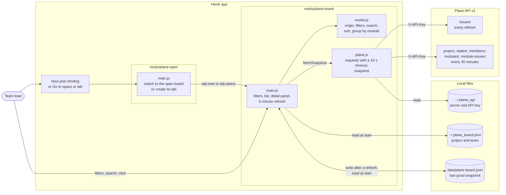

# herdr-app-plane

A read-only board for [Herdr](https://herdr.dev) that shows a team's work items from a [Plane](https://plane.so) project, grouped by module. It talks to the Plane API v1, and it was built against a self-hosted Plane server. Each row shows who owns the item, who created it, its state, its dates, and its priority. When the board can't reach Plane, it keeps showing the last data it fetched.

The board is built for a team lead. It sorts every item by where it came from: the lead's own work, work the lead delegated, work the team created, and work from outside the team.

The repository has two Herdr mods:

- `mods/plane-board` is the board.
- `mods/plane-open` opens the board in a tab, or switches to the tab that already shows it.

## How the pieces fit together

`main.js` owns the screen and the refresh timer. `plane.js` is the only file that talks to Plane. `model.js` holds the filter, search, sort, and grouping rules as pure functions, so Node can test it without Herdr.



## Before you start

You need the following:

- The Herdr app, with its home folder at `~/.config/herdr-app`.
- A Plane workspace and a Plane API key for it. Plane sends the key in the `X-API-Key` header.
- Node.js 18 or later, to run the tests.

## Install the mods

Herdr loads mods from `~/.config/herdr-app/mods`. Link the two folders from this repository there, so that a `git pull` updates the running board.

1. Clone the repository.

	```sh
	git clone https://github.com/LuisBDev/herdr-app-plane.git
	cd herdr-app-plane
	```

2. Link the mod folders. On Windows, run the following commands in PowerShell.

	```powershell
	New-Item -ItemType Junction -Path "$HOME\.config\herdr-app\mods\plane-board" -Target "$PWD\mods\plane-board"
	New-Item -ItemType Junction -Path "$HOME\.config\herdr-app\mods\plane-open" -Target "$PWD\mods\plane-open"
	```

	On Linux or macOS, use symbolic links.

	```sh
	ln -s "$PWD/mods/plane-board" ~/.config/herdr-app/mods/plane-board
	ln -s "$PWD/mods/plane-open" ~/.config/herdr-app/mods/plane-open
	```

3. Check that Herdr loads both mods.

	```sh
	herdr-app check ~/.config/herdr-app/mods/plane-board
	herdr-app check ~/.config/herdr-app/mods/plane-open
	```

	Each command prints `check passed` followed by the folder.

Herdr writes `gpui-kit.d.ts` and `jsconfig.json` into each mod folder when it starts. `.gitignore` excludes them.

On Windows, Herdr doesn't see file changes behind a junction. After a `git pull`, close the board's tab and open it again to load the new code.

## Connect the board to Plane

The board reads two files from your home folder. Neither file belongs in the repository.

### Add the server and the API key

`~/.plane_api` holds three `key=value` lines. `planecli` reads the same file, so you may already have it.

```ini
base_url=https://plane.example.com
api_key=<your Plane API key>
workspace=<workspace slug>
```

Use the address you open in the browser. The **Abrir en Plane** button builds its link from the same address. Leave `/api/v1` out, because the board adds it. The board never writes to this file, and it keeps the API key out of its cache and off the screen.

### Describe the project and the team

`~/.plane_board.json` names the project and the people the board follows.

```json
{
	"project": "<project UUID>",
	"lead": "<your member UUID>",
	"members": [
		{ "id": "<member UUID>", "label": "Ana" },
		{ "id": "<member UUID>", "label": "Ben" }
	]
}
```

- `project` is the UUID of the Plane project.
- `lead` is the UUID of the person who reads the board. The **Yo** filter and the origins depend on it.
- `members` lists the rest of the team. Each `label` becomes a button in the person filter.

To find the UUIDs, list the members of the project. Use the values from `~/.plane_api`.

```sh
curl -H "X-API-Key: $API_KEY" "$BASE_URL/api/v1/workspaces/$WORKSPACE/projects/$PROJECT/members/"
```

If the file is missing or a UUID is malformed, the board shows the problem instead of the list.

## Open the board

To open the board for the first time, run the following command.

```sh
herdr-app do tab.new --name Plane --mod plane-board
```

Herdr saves the tab with its space, so the board comes back when Herdr restarts. To return to it later, press `ctrl-shift-p`, choose **Go to space or tab…**, and type `Plane`.

To open the board with a key, add a binding to `~/.config/herdr-app/keys.json`. The binding runs `plane-open`, which switches to the open board instead of opening a second one.

```json
{ "global": { "ctrl-shift-y": "mod.open:plane-open" } }
```

## Read the board

Three filters at the top decide which items the list shows. The labels on screen are in Spanish.

- **Origin** puts every item in exactly one of four groups. *Propias* are items the lead created that nobody else owns. *Delegadas* are items the lead created and assigned to someone else. *Del equipo* are items a team member created. *Externas* are items someone outside the team created and assigned to the team.
- **Person** keeps the items assigned to one person, or the items with no assignee.
- **Period** keeps every open item and the items closed in the last 7, 14, or 30 days. The box next to it takes any number of days from 1 to 3650. **Todo** turns the period off.

The search box finds an item by its number (`413` or `ABC-413`) or by the words in its title. It ignores case and accents. A search looks through every period, because the item you want may have closed months ago.

Items appear once per module they belong to. Modules with more open items come first, and items without a module go to **Sin módulo** at the end. A target date shows in red when the item is still open and the date has passed. Click a row to see the item's description and a button that opens it in Plane.

## How the board talks to Plane

The board refreshes every 5 minutes, and **↻** refreshes it at once. Every refresh downloads the work items, about 4 requests for 400 items. The project, states, members, and module membership take one request per module plus four, so the board reuses them for 30 minutes. It downloads them again sooner when a new item appears or when you press **↻**. Plane answers HTTP 429 when requests arrive too fast, and fewer requests per refresh keep the board under that limit.

Each request times out after 10 seconds. When a refresh fails, the board keeps the last data and shows a banner with the time of that data and the reason. The board stores that data in `~/.config/herdr-app/data/plane-board.json`. The cache has no descriptions, so the detail panel shows them only after a successful refresh.

## Run the tests

The tests cover the filters, the search, the sort, the grouping, the team file, and the catalog reuse rules in `model.js`.

```sh
node --test test/model.test.mjs
```
